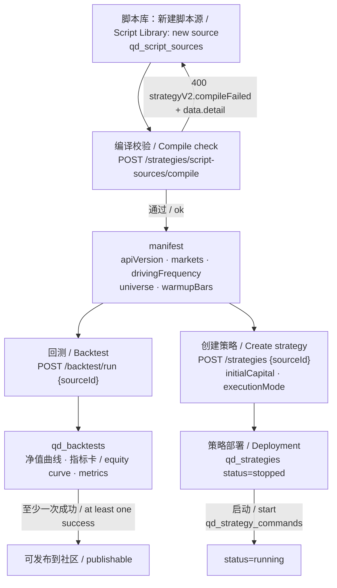
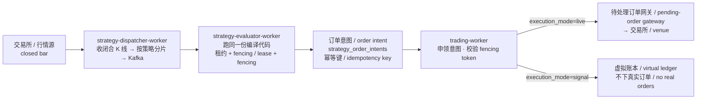
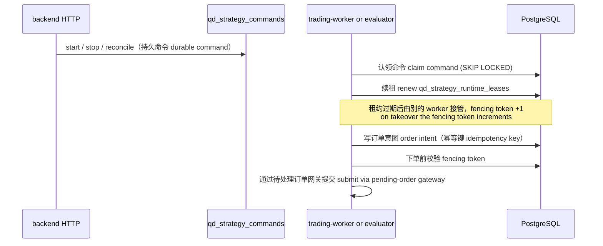

# Strategy Lifecycle: Source → Backtest → Deployment → Orders

How a Strategy API V2 script becomes a running strategy, and which process owns
each step. Diagrams are bilingual (`EN / 中文`); identifiers, tables, and process
names stay in English because they are contractual.

本文说明一段 Strategy API V2 脚本如何变成在跑的策略，以及每一步由哪个进程负责。

## 1. Three objects, not one / 三个对象，不是一个

| Object 对象 | Table 表 | What it is 是什么 |
| --- | --- | --- |
| Script source 脚本源 | `qd_script_sources` | The code (`initialize` / `handle_data`) plus a version history. 代码本身 + 版本历史。 |
| Deployment 策略部署 | `qd_strategies` | A source bound to capital, `execution_mode` (`signal` / `live`) and a status (`stopped` / `running`). 脚本 + 资金 + 模式 + 启停状态。 |
| Backtest run 回测记录 | `qd_backtests` | One historical run of a source or deployment, with its equity curve. 一次历史回测及其净值曲线。 |

**Compile never registers a strategy.** `POST /api/strategies/script-sources/compile`
only validates the script and returns its manifest
(`apiVersion`, `markets`, `drivingFrequency`, `universe`, `warmupBars`). Creating a
deployment is a separate call, `POST /api/strategies` with `sourceId`.

**编译不会注册策略。** 编译只校验代码并返回 manifest；创建策略是另一次调用
（`POST /api/strategies` 传 `sourceId`）。历史上一批「脚本建好了但回测选不到」的
报障就来自把这两件事当成一件。

## 2. Authoring and verification / 创作与验证

The backtest engine and the live runtime call the **same** `compile_strategy_v2(code)`
and run the same handlers; only the data source differs (historical bars vs live
bars). A passing backtest therefore proves the logic executes — not that it is
profitable.

回测与实盘调用**同一个** `compile_strategy_v2(code)`、跑同一份 handler，只是数据源不同
（历史 K 线 vs 实时 K 线）。所以回测通过证明的是「逻辑能跑通」，不是「能赚钱」。

## 3. Runtime pipeline / 运行流水线

- `signal` mode is the default: signals and virtual fills only. `live` requires a
  stored broker credential and passes the live preflight (market/account checks)
  plus the optional AI decision filter.
- Grid, martingale, DCA, tick- and session-driven strategies stay on the realtime
  `trading-worker` path instead of the closed-bar pipeline; grid state is
  checkpointed in `qd_grid_actor_state` and its events in `qd_grid_actor_events`.

## 4. Ownership, leases, and fencing / 归属、租约与围栏

Invariants that must hold when changing any of this（改动时不得破坏）:

- HTTP processes never run trading loops; they only submit durable commands.
- `strategy-evaluator-worker` may create order intents but **never** submit exchange orders.
- Only the worker holding the lease may act; a stale `fencing token` cannot place orders.
- One idempotency key per logical signal, so a replayed bar does not double-trade.
- PostgreSQL is the source of truth; Kafka offsets are not business state.

Cross-references: [process roles](PROCESS_ROLES_AND_TASKS.md),
[concurrency model](CONCURRENCY_MODEL.md), [API conventions](API_CONVENTIONS.md).
